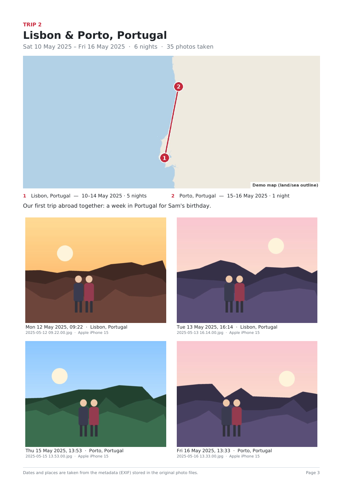
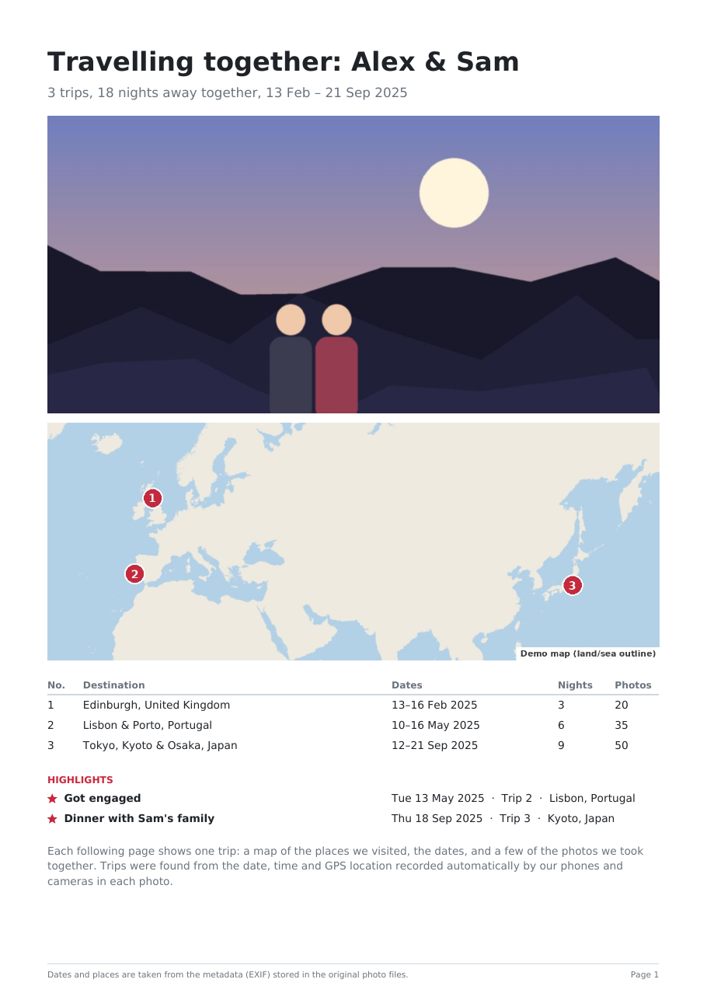
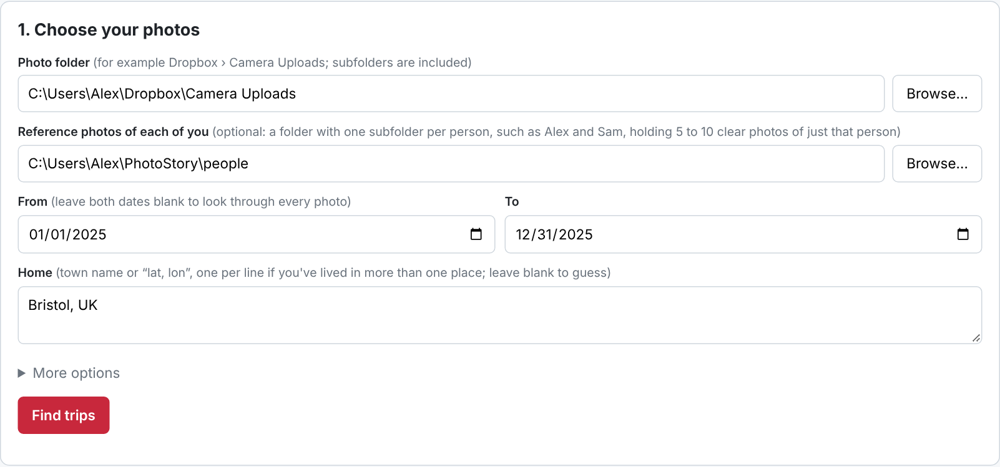
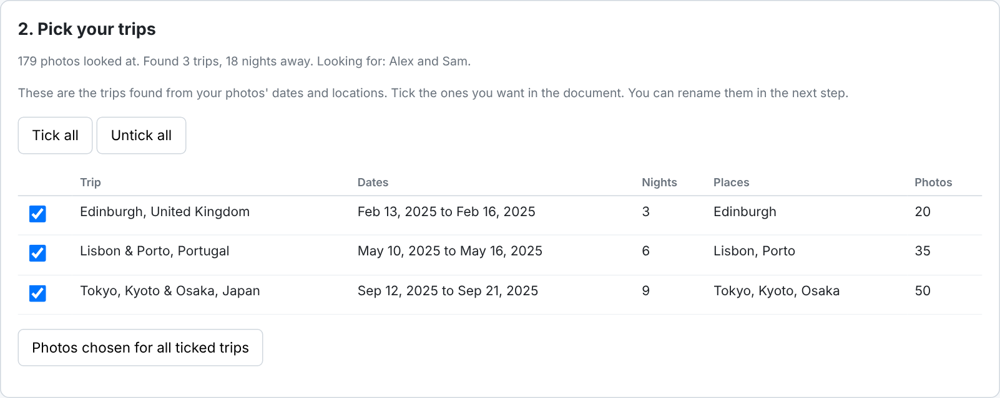
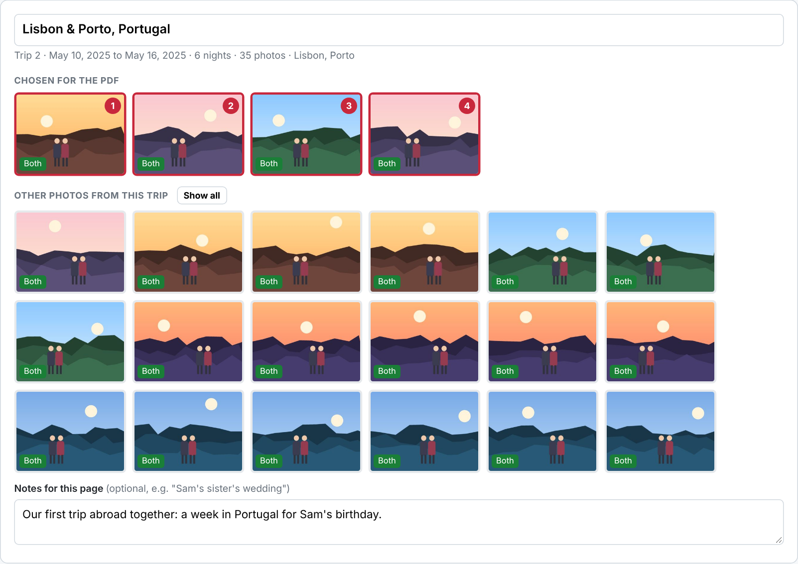

# PhotoStory

Makes a short PDF of the trips you took together, from your own photos: a cover page with an overview
map and a list of trips, then one page per trip with a map of the places you visited, the dates, how many
nights, and a few photos of the two of you.

Everything runs on your computer. Your photos are not uploaded anywhere. The only things fetched from
the internet are map tiles and place names (OpenStreetMap), and the face models the first time.

## What it looks like

These screenshots use made-up demo photos and names. In the real app the maps are OpenStreetMap street maps.

| A page per trip | The cover page |
| --- | --- |
|  |  |

**Choose your photos and dates**



**Tick the trips you want from the ones it found**



**Check each trip and swap photos** (green tags mark photos where both of you were recognised)



## Start it

1. Install Python 3 from <https://www.python.org/downloads/> if you don't have it
   (on Windows, tick "Add Python to PATH" in the installer).
2. Double-click **start-mac.command** (Mac) or **start-windows.bat** (Windows).
   The first run takes a minute or two to install what it needs. On a Mac, if it says the file can't be
   opened, right-click it, choose Open, then Open again.
3. Your browser opens the PhotoStory page.

## Use it

1. **Photo folder**: your Dropbox photos, e.g. `Dropbox/Camera Uploads`. Subfolders are included.
   If Dropbox keeps files "online-only", PhotoStory will make Dropbox download every photo it reads,
   so pick a folder that's available offline, or expect the first scan to take a while.
2. **Reference photos** (optional but recommended): make a folder like this
   ```
   people/
     Alex/    5 to 10 photos with only Alex's face in them
     Sam/   5 to 10 photos with only Sam's face in them
   ```
   Use clear photos from different years and angles. The subfolder names are used as your names.
   With these, PhotoStory picks photos where both of you are recognised. Without them, it picks sharp
   photos spread across each trip and you choose.
3. **From / To**: the date range to cover. Leave both blank to look through every photo.
4. **Home**: your town, e.g. `Bristol, UK`. Anything more than 50 km from home counts as a trip.
   Add a line for each place if you've lived in more than one.
5. Click **Find trips**. The first scan of a big folder can take a while; later scans are fast.
   You get a list of the trips it found, with dates, nights and places.
6. Tick the trips you want, then click **Choose photos for the ticked trips**. Photos are only
   analysed for the trips you tick, so this stays quick even if you scanned years of photos.
7. Check each trip: rename it, click photos to add or remove them, and add a note if it helps
   (e.g. "Sam's sister's wedding"). You can tick more trips later and choose photos for those too.
8. Click **Make PDF**. PDFs are saved in the `PhotoStory` folder in your home folder.

Your edits are kept if you run **Find trips** again with a wider date range.

## How trips are worked out

* Each photo's date, time and GPS position come from the photo file itself (EXIF), the data your phone
  records when you take it. Photos without a date are skipped.
* A trip is a run of photos taken away from home, with no gap of more than 36 hours. Trips shorter than
  one night are skipped unless you change "Shortest trip" to 0.
* Within a trip, photos within 30 km of each other are one stop. The nights at each stop are guessed from
  where the last photo of each day was taken.
* Photos without GPS, taken during a trip, are included in that trip.

## Command line (optional)

```
python -m photostory scan --photos "~/Dropbox/Camera Uploads" --people ~/PhotoStory/people \
    --from 2023-01-01 --to 2025-12-31 --home "Bristol, UK"
python -m photostory pdf
```
